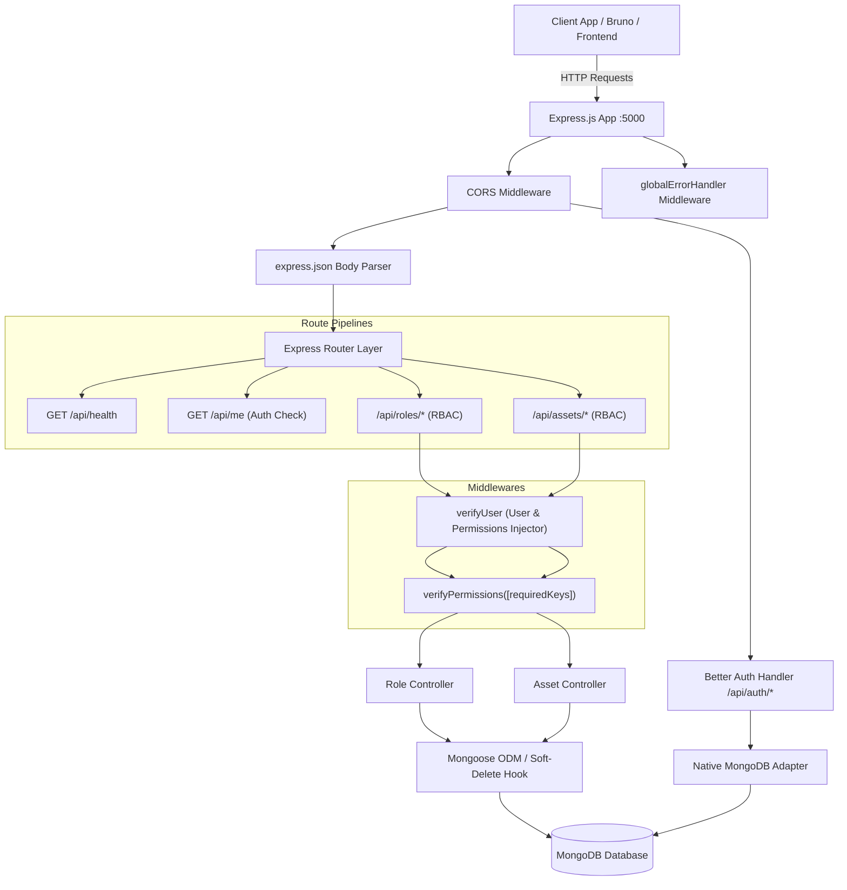

# HRMS Server API Documentation & Data Demo

Comprehensive technical documentation, route catalog, schema definitions, and payload demonstrations for **HRMS-Server**.

---

## 1. Project Overview & Architecture

**HRMS-Server** is an enterprise backend service built with Node.js, Express, TypeScript, Mongoose, and [Better Auth](https://www.better-auth.com/). It provides Role-Based Access Control (RBAC), asset tracking, employee management foundation, soft deletion, and audit logging.



### Key Architectural Highlights
- **Framework**: Express.js with TypeScript (`tsx watch` development server).
- **Authentication**: Better-Auth integrated via `@better-auth/mongo-adapter` and native MongoDB driver.
- **Data Persistence**: Mongoose with MongoDB.
- **Security & Authorization**: Granular permissions verified via `verifyPermissions` middleware.
- **Soft Delete Pattern**: Automatic query filtering using Mongoose `pre(/^find/)` hooks, allowing soft deletes without polluting regular queries while supporting recycle bin and restore operations.
- **Partial Unique Indexes**: MongoDB partial unique indexing allowing reuse of unique fields (like `name` or `serialNumber`) once records are soft-deleted.

---

## 2. Environment Configuration

Defined in `.env`:

| Key | Description | Example Value |
|---|---|---|
| `PORT` | HTTP server port | `5000` |
| `PRODUCTION` | Production environment flag (`true` or `false`) | `false` |
| `NODE_ENV` | Environment identifier | `development` / `production` |
| `ALLOW_ORIGIN` | Comma-separated list of allowed CORS origins | `http://localhost:3000,http://localhost:5000` |
| `MONGO_URI` | MongoDB connection string | `mongodb://127.0.0.1:27017/hrms` |
| `BETTER_AUTH_SECRET` | Secret key for Better Auth tokens (>= 32 chars) | `a_very_long_random_secret_string_32_chars` |
| `BETTER_AUTH_URL` | Base URL of Better Auth instance | `http://localhost:5000` |
| `LOG_LEVEL` | Logging threshold (`debug`, `info`, `warn`, `error`) | `info` |

---

## 3. Permission System & RBAC

System permissions are typed constants defined in `src/constants/permissions.constant.ts`.

### Canonical Permission Keys

| Category | Permission Key | Description |
|---|---|---|
| **Employee** | `readEmployeeList` | View paginated employee directory |
| | `readEmployee` | View individual employee profile |
| | `createEmployee` | Register a new employee |
| | `updateEmployee` | Modify employee profile details |
| | `deleteEmployee` | Soft delete an employee |
| **Role** | `readRoleList` | View all system roles |
| | `readRole` | View role details or recycle bin |
| | `createRole` | Create a new RBAC role |
| | `updateRole` | Modify role permissions or description |
| | `deleteRole` | Soft delete a role |
| | `restoreRole` | Restore a deleted role from recycle bin |
| **Department** | `readDepartmentList` | View department listing |
| | `readDepartment` | View single department details |
| | `createDepartment` | Create a new department |
| | `updateDepartment` | Update department details |
| | `deleteDepartment` | Soft delete a department |
| **Assets** | `readAssetList` | View asset inventory |
| | `readAsset` | View single asset details or recycle bin |
| | `createAsset` | Register a new asset |
| | `updateAsset` | Modify asset specifications |
| | `deleteAsset` | Soft delete an asset |
| | `restoreAsset` | Restore a deleted asset |
| | `assignAsset` | Assign asset to an employee |

---

## 4. API Route Index

### 4.1 System & Diagnostic Endpoints

| Method | Endpoint | Auth | Required Permissions | Description |
|---|---|---|---|---|
| `GET` | `/api/health` | None | None | Service heartbeat & health check |
| `GET` | `/api/me` | Session | Valid Better-Auth Session | Retrieves current authenticated session |

### 4.2 Better-Auth Endpoints (`/api/auth/*`)

Handled natively by Better-Auth:

| Method | Endpoint | Description |
|---|---|---|
| `POST` | `/api/auth/sign-up/email` | Create new user with email & password |
| `POST` | `/api/auth/sign-in/email` | Authenticate with email & password |
| `POST` | `/api/auth/sign-out` | Terminate session and invalidate cookie |
| `GET` | `/api/auth/get-session` | Inspect active session payload |

### 4.3 Role Management Endpoints (`/api/roles`)

| Method | Endpoint | Required Permissions | Description |
|---|---|---|---|
| `GET` | `/api/roles` | `readRoleList` | List active roles (paginated) |
| `GET` | `/api/roles/recycle_bin` | `readRole` | List soft-deleted roles in recycle bin |
| `GET` | `/api/roles/:id` | `readRole` | Get role by ID (active or deleted) |
| `POST` | `/api/roles` | `createRole` | Create a new role |
| `PUT` | `/api/roles/:id` | `updateRole` | Update role fields or permissions |
| `DELETE` | `/api/roles/:id` | `deleteRole` | Soft-delete a role |
| `PATCH` | `/api/roles/:id/restore` | `restoreRole` | Restore soft-deleted role |

### 4.4 Asset Management Endpoints (`/api/assets`)

| Method | Endpoint | Required Permissions | Description |
|---|---|---|---|
| `GET` | `/api/assets` | `readAssetList` | List active assets (paginated) |
| `GET` | `/api/assets/recycle_bin` | `readAsset` | List soft-deleted assets in recycle bin |
| `GET` | `/api/assets/:id` | `readAsset` | Get asset by ID (active or deleted) |
| `POST` | `/api/assets` | `createAsset` | Create a new asset |
| `PUT` | `/api/assets/:id` | `updateAsset` | Update asset details |
| `DELETE` | `/api/assets/:id` | `deleteAsset` | Soft-delete an asset |
| `PATCH` | `/api/assets/:id/restore` | `restoreAsset` | Restore soft-deleted asset |

---

## 5. Detailed Route Catalog & Data Demos

---

### 5.1 System Endpoints

#### `GET /api/health`
- **Description**: Verifies server responsiveness.
- **Headers**: None required.
- **Request Parameters / Body**: None.
- **Success Response (`200 OK`)**:
```json
{
  "message": "hems Server is running successfully!"
}
```

---

#### `GET /api/me`
- **Description**: Returns authenticated user and session data from Better Auth cookies / headers.
- **Headers**: `Cookie: better-auth.session_token=...` or `Authorization: Bearer ...`
- **Success Response (`200 OK`)**:
```json
{
  "session": {
    "id": "sess_67b61a3f019b8",
    "userId": "usr_67b61a20019a1",
    "expiresAt": "2026-11-20T09:22:07.000Z",
    "token": "4a719c23f85890b0e980...",
    "createdAt": "2026-10-20T15:20:00.000Z",
    "updatedAt": "2026-10-20T15:20:00.000Z",
    "ipAddress": "127.0.0.1",
    "userAgent": "Bruno/OpenCollection"
  },
  "user": {
    "id": "usr_67b61a20019a1",
    "name": "Admin User",
    "email": "admin@example.com",
    "emailVerified": true,
    "createdAt": "2026-10-20T15:00:00.000Z",
    "updatedAt": "2026-10-20T15:00:00.000Z"
  }
}
```
- **Error Response (`401 Unauthorized`)**:
```json
{
  "message": "Unauthorized"
}
```

---

### 5.2 Role Endpoints (`/api/roles`)

#### `GET /api/roles`
- **Description**: Retrieves all non-deleted roles. Supports pagination.
- **Required Permission**: `readRoleList`
- **Query Parameters**:
  - `page` (optional, default: `1`): Page number.
  - `limit` (optional, default: `10`): Items per page.
- **Request Example**: `GET /api/roles?page=1&limit=2`
- **Success Response (`200 OK`)**:
```json
{
  "success": true,
  "message": "Roles retrieved successfully",
  "data": [
    {
      "_id": "67b61f8875317d7b38d40a12",
      "name": "Super Admin",
      "description": "Full access to all system features",
      "status": "active",
      "permissions": {
        "readEmployeeList": true,
        "readEmployee": true,
        "createEmployee": true,
        "updateEmployee": true,
        "deleteEmployee": true,
        "readRoleList": true,
        "readRole": true,
        "createRole": true,
        "updateRole": true,
        "deleteRole": true,
        "restoreRole": true,
        "readDepartmentList": true,
        "readDepartment": true,
        "createDepartment": true,
        "updateDepartment": true,
        "deleteDepartment": true,
        "readAssetList": true,
        "assignAsset": true,
        "createAsset": true,
        "readAsset": true,
        "updateAsset": true,
        "deleteAsset": true,
        "restoreAsset": true
      },
      "createdBy": "6ad4729e856ea46aefdb1ff3",
      "isDeleted": false,
      "deletedAt": null,
      "deletedBy": null,
      "createdAt": "2026-10-20T08:00:00.000Z",
      "updatedAt": "2026-10-20T08:00:00.000Z"
    }
  ]
}
```

---

#### `GET /api/roles/recycle_bin`
- **Description**: Retrieves soft-deleted roles only (`isDeleted: true`).
- **Required Permission**: `readRole`
- **Query Parameters**: `page` (default `1`), `limit` (default `10`).
- **Success Response (`200 OK`)**:
```json
{
  "success": true,
  "message": "Deleted roles retrieved successfully",
  "data": [
    {
      "_id": "6ad47d6e4af4dcb71a01a2f3",
      "name": "Intern",
      "description": "Temporary trainee access",
      "status": "inactive",
      "permissions": {
        "readEmployeeList": true,
        "readRoleList": false
      },
      "createdBy": "6ad4729e856ea46aefdb1ff3",
      "isDeleted": true,
      "deletedAt": "2026-10-20T10:30:15.000Z",
      "deletedBy": "6ad4729e856ea46aefdb1ff3",
      "createdAt": "2026-10-18T05:00:00.000Z",
      "updatedAt": "2026-10-20T10:30:15.000Z"
    }
  ]
}
```

---

#### `GET /api/roles/:id`
- **Description**: Retrieves a single role by its 24-character hexadecimal ObjectId. Includes soft-deleted records if queried directly.
- **Required Permission**: `readRole`
- **URL Parameters**: `id` - Valid MongoDB ObjectId string.
- **Success Response (`200 OK`)**:
```json
{
  "success": true,
  "message": "Role retrieved successfully",
  "data": {
    "_id": "6ad47d6e4af4dcb71a01a2f3",
    "name": "HR Manager",
    "description": "Handles employee onboarding and role management",
    "status": "active",
    "permissions": {
      "readEmployeeList": true,
      "createEmployee": true,
      "updateEmployee": true,
      "deleteEmployee": false,
      "readRoleList": true,
      "createRole": false,
      "updateRole": false,
      "deleteRole": false,
      "restoreRole": false,
      "readDepartmentList": true,
      "readAssetList": true,
      "assignAsset": true
    },
    "createdBy": "6ad4729e856ea46aefdb1ff3",
    "isDeleted": false,
    "createdAt": "2026-10-19T06:15:00.000Z",
    "updatedAt": "2026-10-19T06:15:00.000Z"
  }
}
```
- **Error Responses**:
  - `400 Bad Request` (Invalid ID format):
    ```json
    {
      "success": false,
      "status": 400,
      "message": "Invalid Role ID format."
    }
    ```
  - `404 Not Found`:
    ```json
    {
      "success": false,
      "status": 404,
      "message": "Role not found."
    }
    ```

---

#### `POST /api/roles`
- **Description**: Creates a new role.
- **Required Permission**: `createRole`
- **Headers**: `Content-Type: application/json`
- **Request Body (Demo)**:
```json
{
  "name": "Department Supervisor",
  "description": "Manages team assets and schedules",
  "status": "active",
  "permissions": {
    "readEmployeeList": true,
    "readEmployee": true,
    "readAssetList": true,
    "assignAsset": true,
    "readDepartment": true
  }
}
```
- **Success Response (`201 Created`)**:
```json
{
  "success": true,
  "message": "Role created successfully",
  "data": {
    "_id": "67b6298812c3f85e490a7891",
    "name": "Department Supervisor",
    "description": "Manages team assets and schedules",
    "status": "active",
    "permissions": {
      "readEmployeeList": true,
      "readEmployee": true,
      "createEmployee": false,
      "updateEmployee": false,
      "deleteEmployee": false,
      "readRoleList": false,
      "readRole": false,
      "createRole": false,
      "updateRole": false,
      "deleteRole": false,
      "restoreRole": false,
      "readDepartmentList": false,
      "readDepartment": true,
      "createDepartment": false,
      "updateDepartment": false,
      "deleteDepartment": false,
      "readAssetList": true,
      "assignAsset": true,
      "createAsset": false,
      "readAsset": false,
      "updateAsset": false,
      "deleteAsset": false,
      "restoreAsset": false
    },
    "createdBy": "6ad4729e856ea46aefdb1ff3",
    "isDeleted": false,
    "deletedAt": null,
    "deletedBy": null,
    "createdAt": "2026-10-20T15:25:00.000Z",
    "updatedAt": "2026-10-20T15:25:00.000Z"
  }
}
```
- **Error Responses**:
  - `400 Bad Request` (Missing name):
    ```json
    {
      "success": false,
      "status": 400,
      "message": "Role name is required."
    }
    ```
  - `400 Bad Request` (Duplicate active name):
    ```json
    {
      "success": false,
      "status": 400,
      "message": "Role already exists."
    }
    ```

---

#### `PUT /api/roles/:id`
- **Description**: Dynamically updates fields of an existing role.
- **Required Permission**: `updateRole`
- **Request Body (Demo)**:
```json
{
  "name": "Senior Department Supervisor",
  "description": "Supervises cross-department teams",
  "permissions": {
    "readEmployeeList": true,
    "readEmployee": true,
    "readAssetList": true,
    "assignAsset": true,
    "createAsset": true
  }
}
```
- **Success Response (`200 OK`)**:
```json
{
  "success": true,
  "message": "Role updated successfully",
  "data": {
    "_id": "67b6298812c3f85e490a7891",
    "name": "Senior Department Supervisor",
    "description": "Supervises cross-department teams",
    "status": "active",
    "permissions": {
      "readEmployeeList": true,
      "readEmployee": true,
      "readAssetList": true,
      "assignAsset": true,
      "createAsset": true
    },
    "createdBy": "6ad4729e856ea46aefdb1ff3",
    "updatedBy": "6ad4729e856ea46aefdb1ff3",
    "isDeleted": false,
    "updatedAt": "2026-10-20T15:30:00.000Z"
  }
}
```

---

#### `DELETE /api/roles/:id`
- **Description**: Soft deletes a role by setting `isDeleted = true`, `deletedAt = now`, and `deletedBy = userId`.
- **Required Permission**: `deleteRole`
- **Success Response (`200 OK`)**:
```json
{
  "success": true,
  "message": "Role deleted successfully",
  "data": {
    "_id": "67b6298812c3f85e490a7891",
    "name": "Senior Department Supervisor",
    "isDeleted": true,
    "deletedAt": "2026-10-20T15:32:10.000Z",
    "deletedBy": "6ad4729e856ea46aefdb1ff3",
    "updatedAt": "2026-10-20T15:32:10.000Z"
  }
}
```

---

#### `PATCH /api/roles/:id/restore`
- **Description**: Restores a soft-deleted role back into active circulation.
- **Required Permission**: `restoreRole`
- **Success Response (`200 OK`)**:
```json
{
  "success": true,
  "message": "Role restored successfully",
  "data": {
    "_id": "67b6298812c3f85e490a7891",
    "name": "Senior Department Supervisor",
    "isDeleted": false,
    "deletedAt": null,
    "deletedBy": null,
    "updatedBy": "6ad4729e856ea46aefdb1ff3",
    "updatedAt": "2026-10-20T15:33:45.000Z"
  }
}
```

---

### 5.3 Asset Endpoints (`/api/assets`)

#### `GET /api/assets`
- **Description**: Retrieves all non-deleted assets.
- **Required Permission**: `readAssetList`
- **Query Parameters**:
  - `page` (optional, default: `1`): Current page.
  - `limit` (optional, default: `10`): Items per page.
- **Request Example**: `GET /api/assets?page=1&limit=10`
- **Success Response (`200 OK`)**:
```json
{
  "success": true,
  "message": "Assets retrieved successfully",
  "data": [
    {
      "_id": "6ad5bd5fab21d7af1818467c",
      "assetName": "MacBook Pro 16-inch M3",
      "description": "Engineering workstation laptop",
      "serialNumber": "MBP-2026-98124",
      "status": "active",
      "qty": 1,
      "createdBy": "6ad4729e856ea46aefdb1ff3",
      "isDeleted": false,
      "deletedAt": null,
      "deletedBy": null,
      "createdAt": "2026-10-15T09:00:00.000Z",
      "updatedAt": "2026-10-15T09:00:00.000Z"
    }
  ]
}
```

---

#### `GET /api/assets/recycle_bin`
- **Description**: Retrieves soft-deleted assets.
- **Required Permission**: `readAsset`
- **Query Parameters**: `page`, `limit`.
- **Success Response (`200 OK`)**:
```json
{
  "success": true,
  "message": "Deleted assets retrieved successfully",
  "data": [
    {
      "_id": "6ad5e41fac912eef34567890",
      "assetName": "Dell Ultrasharp Monitor",
      "description": "Defective backlight unit",
      "serialNumber": "DELL-U27-0091",
      "status": "disabled",
      "qty": 1,
      "isDeleted": true,
      "deletedAt": "2026-10-19T14:10:00.000Z",
      "deletedBy": "6ad4729e856ea46aefdb1ff3"
    }
  ]
}
```

---

#### `GET /api/assets/:id`
- **Description**: Fetches single asset details. Queries bypass the soft-delete filter, allowing inspection of deleted records by ID.
- **Required Permission**: `readAsset`
- **URL Parameters**: `id` - Valid MongoDB ObjectId string.
- **Success Response (`200 OK`)**:
```json
{
  "success": true,
  "message": "Asset retrieved successfully",
  "data": {
    "_id": "6ad5bd5fab21d7af1818467c",
    "assetName": "MacBook Pro 16-inch M3",
    "description": "Engineering workstation laptop",
    "serialNumber": "MBP-2026-98124",
    "status": "active",
    "qty": 1,
    "createdBy": "6ad4729e856ea46aefdb1ff3",
    "isDeleted": false,
    "createdAt": "2026-10-15T09:00:00.000Z",
    "updatedAt": "2026-10-15T09:00:00.000Z"
  }
}
```
- **Error Response (`404 Not Found`)**:
```json
{
  "success": false,
  "message": "Asset not found"
}
```

---

#### `POST /api/assets`
- **Description**: Creates a new inventory asset item.
- **Required Permission**: `createAsset`
- **Request Body (Demo)**:
```json
{
  "assetName": "Sony Alpha A7 IV Camera",
  "description": "Media production 4K streaming camera",
  "serialNumber": "SN-SONY-778899",
  "status": "active",
  "qty": 1
}
```
- **Success Response (`201 Created`)**:
```json
{
  "success": true,
  "message": "Asset created successfully",
  "data": {
    "_id": "67b631998f45a190b8c31245",
    "assetName": "Sony Alpha A7 IV Camera",
    "description": "Media production 4K streaming camera",
    "serialNumber": "SN-SONY-778899",
    "status": "active",
    "qty": 1,
    "createdBy": "6ad4729e856ea46aefdb1ff3",
    "isDeleted": false,
    "deletedAt": null,
    "deletedBy": null,
    "createdAt": "2026-10-20T15:40:00.000Z",
    "updatedAt": "2026-10-20T15:40:00.000Z"
  }
}
```
- **Error Response (`400 Bad Request`)**:
```json
{
  "success": false,
  "status": 400,
  "message": "Asset name is required."
}
```

---

#### `PUT /api/assets/:id`
- **Description**: Updates asset properties dynamically.
- **Required Permission**: `updateAsset`
- **Request Body (Demo)**:
```json
{
  "description": "Media production 4K streaming camera (Assigned to Studio A)",
  "status": "active"
}
```
- **Success Response (`200 OK`)**:
```json
{
  "success": true,
  "message": "Asset updated successfully",
  "data": {
    "_id": "67b631998f45a190b8c31245",
    "assetName": "Sony Alpha A7 IV Camera",
    "description": "Media production 4K streaming camera (Assigned to Studio A)",
    "serialNumber": "SN-SONY-778899",
    "status": "active",
    "qty": 1,
    "updatedBy": "6ad4729e856ea46aefdb1ff3",
    "isDeleted": false,
    "updatedAt": "2026-10-20T15:42:15.000Z"
  }
}
```

---

#### `DELETE /api/assets/:id`
- **Description**: Soft deletes an asset record.
- **Required Permission**: `deleteAsset`
- **Success Response (`200 OK`)**:
```json
{
  "success": true,
  "message": "Asset deleted successfully",
  "data": {
    "_id": "67b631998f45a190b8c31245",
    "assetName": "Sony Alpha A7 IV Camera",
    "isDeleted": true,
    "deletedBy": "6ad4729e856ea46aefdb1ff3",
    "deletedAt": "2026-10-20T15:44:00.000Z"
  }
}
```

---

#### `PATCH /api/assets/:id/restore`
- **Description**: Restores a soft-deleted asset back into the active pool.
- **Required Permission**: `restoreAsset`
- **Success Response (`200 OK`)**:
```json
{
  "success": true,
  "message": "Asset restored successfully",
  "data": {
    "_id": "67b631998f45a190b8c31245",
    "assetName": "Sony Alpha A7 IV Camera",
    "isDeleted": false,
    "deletedBy": null,
    "deletedAt": null
  }
}
```

---

## 6. Data Models & Schemas

### 6.1 Role Model (`Role`)
Located at `src/models/role.model.ts`:

```typescript
{
  name: { type: String, required: true, trim: true },
  description: { type: String, default: '', trim: true },
  status: { type: String, enum: ['active', 'inactive', 'disabled'], default: 'active', index: true },
  permissions: {
    readEmployeeList: Boolean,
    readEmployee: Boolean,
    createEmployee: Boolean,
    updateEmployee: Boolean,
    deleteEmployee: Boolean,
    readRoleList: Boolean,
    readRole: Boolean,
    createRole: Boolean,
    updateRole: Boolean,
    deleteRole: Boolean,
    restoreRole: Boolean,
    readDepartmentList: Boolean,
    readDepartment: Boolean,
    createDepartment: Boolean,
    updateDepartment: Boolean,
    deleteDepartment: Boolean,
    readAssetList: Boolean,
    assignAsset: Boolean,
    createAsset: Boolean,
    readAsset: Boolean,
    updateAsset: Boolean,
    deleteAsset: Boolean,
    restoreAsset: Boolean
  },
  createdBy: { type: Schema.Types.ObjectId, ref: 'User', required: true },
  updatedBy: { type: Schema.Types.ObjectId, ref: 'User' },
  isDeleted: { type: Boolean, default: false, index: true },
  deletedAt: { type: Date, default: null },
  deletedBy: { type: Schema.Types.ObjectId, ref: 'User', default: null },
  createdAt: Date,
  updatedAt: Date
}
```
* **Indexes**: `{ name: 1 }` unique partial index where `isDeleted: false`.

---

### 6.2 Asset Model (`Asset`)
Located at `src/models/asset.model.ts`:

```typescript
{
  assetName: { type: String, required: true, trim: true, index: true },
  description: { type: String, default: '', trim: true },
  serialNumber: { type: String, trim: true },
  status: { type: String, enum: ['active', 'inactive', 'disabled'], default: 'active', index: true },
  qty: { type: Number, default: 0, min: 0 },
  createdBy: { type: Schema.Types.ObjectId, ref: 'User', required: true },
  updatedBy: { type: Schema.Types.ObjectId, ref: 'User' },
  isDeleted: { type: Boolean, default: false, index: true },
  deletedAt: { type: Date, default: null },
  deletedBy: { type: Schema.Types.ObjectId, ref: 'User', default: null },
  createdAt: Date,
  updatedAt: Date
}
```
* **Indexes**: `{ serialNumber: 1 }` unique partial index where `serialNumber exists` and `isDeleted: false`.

---

### 6.3 Asset Assignment Model (`AssetAssign`)
Located at `src/models/assetAssign.model.ts`:

```typescript
{
  asset: { type: Schema.Types.ObjectId, ref: 'Asset', required: true, index: true },
  user: { type: Schema.Types.ObjectId, ref: 'User', required: true, index: true },
  itemQty: { type: Number, required: true, min: 1 },
  status: { 
    type: String, 
    enum: ['active', 'inactive', 'disabled', 'assigned', 'returned'], 
    default: 'assigned', 
    index: true 
  },
  createdBy: { type: Schema.Types.ObjectId, ref: 'User', required: true },
  updatedBy: { type: Schema.Types.ObjectId, ref: 'User' },
  isDeleted: { type: Boolean, default: false, index: true },
  deletedAt: { type: Date, default: null },
  deletedBy: { type: Schema.Types.ObjectId, ref: 'User', default: null },
  createdAt: Date,
  updatedAt: Date
}
```

---

## 7. Error Handling Standard

All operational and validation errors are intercepted by `globalErrorHandler` (`src/utility/globalErrorHandler.ts`).

### Error Response Schema
```json
{
  "success": false,
  "status": 403,
  "message": "Insufficient permissions"
}
```

### Standard Status Codes
- `200 OK`: Request succeeded.
- `201 Created`: Resource successfully created.
- `400 Bad Request`: Validation failure or missing required fields.
- `401 Unauthorized`: Session token missing or invalid.
- `403 Forbidden`: Authenticated user lacks required permissions in `req.permissions`.
- `404 Not Found`: Requested document or route not found.
- `500 Internal Server Error`: Unhandled server or database exception.

---

## 8. Bruno API Test Collection

The repository includes pre-configured [Bruno](https://www.usebruno.com/) collection files in `API_TEST/HRMS/`:

- **Role Requests**:
  - `AllRole.yml`: `GET /api/roles`
  - `Role By ID.yml`: `GET /api/roles/:id`
  - `Role recycle bin.yml`: `GET /api/roles/recycle_bin`
  - `Create Role.yml`: `POST /api/roles`
  - `Update Role.yml`: `PUT /api/roles/:id`
  - `Delete Role.yml`: `DELETE /api/roles/:id`
  - `Restore Role.yml`: `PATCH /api/roles/:id/restore`
- **Asset Requests**:
  - `AllAssert.yml`: `GET /api/assets`
  - `Assert By ID.yml`: `GET /api/assets/:id`
  - `Assert recycle bin.yml`: `GET /api/assets/recycle_bin`
  - `Create Assert.yml`: `POST /api/assets`
  - `Update Assert.yml`: `PUT /api/assets/:id`
  - `Delete Assert.yml`: `DELETE /api/assets/:id`
  - `Restore Assert.yml`: `PATCH /api/assets/:id/restore`
